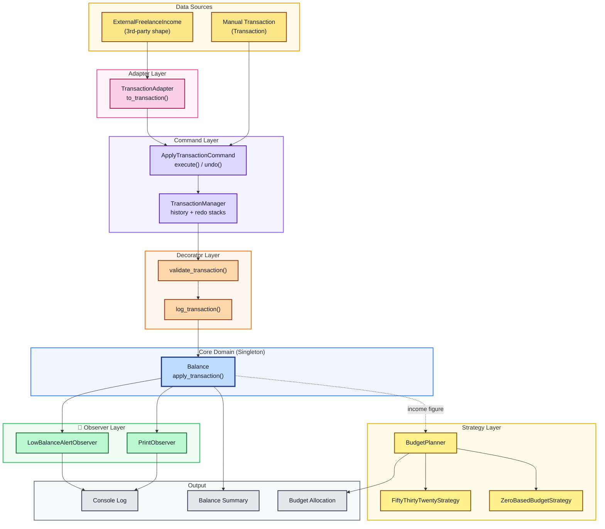

# OOP Design Patterns Financial Manager

## Freelancer Personal Finance Manager


A lightweight, dependency-free Python console application that helps freelancers and gig workers track income, expenses, and budgets, built as a hands-on demonstration of six classic object-oriented design patterns working together in one small, fully-tested codebase.

> This README summarizes the full **[Freelancer Finance Manager Report](.doc/Freelancer_Finance_Manager_Report.pdf)**, a 29-page technical report covering the problem statement, architecture, pattern-by-pattern implementation, testing methodology, and live-run results in detail. Read this file for a quick orientation; read the report for the complete analysis.

---

## Table of Contents

- [Overview](#overview)
- [Features](#features)
- [Architecture](#architecture)
- [Design Patterns at a Glance](#design-patterns-at-a-glance)
- [Project Structure](#project-structure)
- [Requirements](#requirements)
- [Installation](#installation)
- [Usage](#usage)
- [Example Run](#example-run)
- [Testing](#testing)
- [Enhancements / Standouts](#enhancements--standouts)
- [Value Proposition](#value-proposition)
- [Limitations](#limitations)
- [Roadmap](#roadmap)
- [References](#references)

---

## Overview

Freelancers and gig workers do not have a payroll department managing their money for them. According to Upwork's *Freelance Forward 2023* study, 64 million Americans (38% of the U.S. workforce) freelanced in the prior year, contributing an estimated $1.27 trillion in annual earnings, income that arrives irregularly, from multiple platforms, with no automatic withholding.

This project addresses that gap with a small, well-factored application built around a single authoritative balance, pluggable alerts, reversible transactions, and swappable budgeting strategies, rather than a rigid, single-purpose script. Every one of the six design patterns used here does real, load-bearing work: removing any one of them would break a specific, observable piece of functionality.

## Features

- **Single source of truth balance** that every part of the app reads and writes consistently
- **Pluggable income adapters** to ingest transactions from third-party formats (e.g. freelance marketplaces) without touching core logic
- **Configurable alerts** that fire automatically when the balance drops below a threshold
- **Full undo / redo** of any applied transaction, including reversal of adapted or income transactions
- **Two swappable budgeting strategies** (50/30/20 rule and zero-based budgeting), chosen at runtime
- **Automatic validation and audit logging** on every balance-changing operation
- **29-case automated test suite** covering every pattern and its edge cases

## Architecture

The application is organized into three Python packages, `balance`, `transaction`, and `budget`, coordinated from a single `main.py` composition root. Every collaborator is *injected* into the class that needs it rather than being constructed internally, which is what keeps the packages mutually decoupled and independently testable.

The diagram below shows the full data flow: how a transaction enters the system (from either a manually constructed `Transaction` or an adapted third-party `ExternalFreelanceIncome` record), how it is executed and made reversible by the Command layer, validated and logged by the Decorator layer, applied to the Singleton `Balance`, broadcast to Observers, and how that same balance feeds the Strategy-based budget planner. Each stage of the pipeline is grouped and colored separately so the flow is easy to trace at a glance.



**Reading the diagram:** a transaction always converges on the Command layer before it ever touches the balance, regardless of whether it originated internally or was adapted from an external source. The Decorator layer sits directly in front of the Singleton, so nothing reaches `Balance.apply_transaction` unvalidated or unlogged. Once the balance updates, two independent things happen in parallel: registered Observers are notified (solid path), and the current balance figure becomes available to the Strategy-based budget planner on request (dashed path), which fans out into whichever budgeting algorithm is currently active.

## Design Patterns at a Glance

| # | Pattern | Class(es) | Role in the Flow |
|---|---------|-----------|-------------------|
| 1 | **Singleton** | `Balance` | Exactly one authoritative balance, reachable only via `get_instance()` |
| 2 | **Adapter** | `TransactionAdapter` | Converts `ExternalFreelanceIncome` into the app's own `Transaction` shape |
| 3 | **Observer** | `PrintObserver`, `LowBalanceAlertObserver` | Decouples "what happens on a balance change" from the balance logic itself |
| 4 | **Command** | `ApplyTransactionCommand`, `TransactionManager` | Wraps every transaction so it can be executed, undone, and redone |
| 5 | **Strategy** | `BudgetStrategy`, `FiftyThirtyTwentyStrategy`, `ZeroBasedBudgetStrategy`, `BudgetPlanner` | Lets the budgeting algorithm be swapped at runtime |
| 6 | **Decorator** | `validate_transaction`, `log_transaction` | Layers validation and audit logging onto `apply_transaction` without cluttering it |
| - | **Dependency Injection** | applied throughout `main.py` | The connective principle: every class above depends on an abstraction it is handed, never one it constructs itself |

Patterns 1-3 are the fundamental patterns required by the underlying project specification; Command was chosen as the fourth required pattern *and* doubles as the first standout (undo/redo); Strategy and Decorator are the remaining two standouts. All six patterns are load-bearing, not decorative: removing any one breaks a specific, observable feature.

## Project Structure

```
./
├── main.py                                 # Composition root: wires every pattern together
├── README.md                               # This file
|── doc
|   ├── Freelancer_Finance_Manager_Report.pdf  # Full 29-page technical report
├── balance/
│   ├── balance.py                          # Singleton Balance (Observer subject)
│   ├── balance_observer.py                 # Observer interface + concrete observers
│   ├── test_balance.py
│   └── test_balance_observer.py
├── transaction/
│   ├── transaction.py                      # Transaction value object + TransactionCategory enum
│   ├── transaction_adapter.py              # Adapter pattern
│   ├── external_income_transaction.py      # Third-party data shape being adapted
│   ├── transaction_command.py              # Command pattern (undo / redo)
│   ├── transaction_decorator.py            # Decorator pattern (validation + logging)
│   ├── test_transaction.py
│   ├── test_transaction_adapter.py
│   ├── test_transaction_command.py
│   └── test_transaction_decorator.py
└── budget/
    ├── budget_strategy.py                  # Strategy pattern (budget planning)
    └── test_budget_strategy.py
```

## Requirements

- Python 3.8 or later
- No third-party packages. Everything used (`unittest`, `enum`, `abc`, `functools`, `logging`) is part of the Python standard library.

## Installation

```bash
# Unzip or clone the project, then:
cd <project repository>
python3 --version   # confirm 3.8+
```

No `pip install` step is required.

## Usage

Run the full demo application:

```bash
python3 main.py
```

This will, in order:

1. Create the Singleton `Balance` and register both observers via dependency injection.
2. Apply four ordinary transactions plus one transaction adapted from an external freelance-income record.
3. Demonstrate **undo** and **redo** of the most recent transaction.
4. Apply a deliberately large expense to **trigger the low-balance alert**.
5. Run the **same income figure through two different budgeting strategies**.
6. Print a final balance summary.

## Example Run

Excerpted from an actual terminal session (see the full transcript for every line):

```
============================================================
Freelancer Personal Finance Manager
============================================================

Adding transactions...
[Balance Update] Applied Transaction($100, category='TransactionCategory.INCOME') -> New balance: $100.00
[Balance Update] Applied Transaction($50, category='TransactionCategory.EXPENSE') -> New balance: $50.00
[ALERT] Balance $50.00 has fallen below threshold $100.00!
...
[Balance Update] Applied Transaction($1200, category='TransactionCategory.INCOME') -> New balance: $1375.00

--- Undo/Redo demo (Command pattern) ---
Undoing last transaction...
Current balance: $175.00
Redoing last transaction...
Current balance: $1375.00

--- Budget planning demo (Strategy pattern) ---
50/30/20 plan for $3000: {'needs': 1500.0, 'wants': 900.0, 'savings': 600.0}
Zero-based plan for $3000: {'rent': 1200.0, 'food': 600.0, 'savings': 600.0, 'fun': 600.0}

Final Current balance: $-25.00
```

## Testing

Run the entire suite with a single command:

```bash
python3 -m unittest discover -v
```

| Test Module | Cases | Result |
|---|---|---|
| `balance.test_balance` | 8 | OK |
| `balance.test_balance_observer` | 1 | OK |
| `transaction.test_transaction` | 3 | OK |
| `transaction.test_transaction_adapter` | 1 | OK |
| `transaction.test_transaction_command` | 7 | OK |
| `transaction.test_transaction_decorator` | 5 | OK |
| `budget.test_budget_strategy` | 4 | OK |
| **Total** | **29** | **OK, 0 failures, 0 errors** |

Testing specifically targets each pattern's edge cases, not just the happy path: Singleton identity across repeated calls, alert thresholds crossed both downward and back upward, undo of both income and expense transactions, undo/redo on an empty stack, strategy interchangeability producing materially different results, and all three ways a transaction can be invalid.

## Enhancements / Standouts

All three optional enhancements requested by the underlying project are fully implemented, not stubbed:

| Standout | Implementation |
|---|---|
| Undo / redo of transactions | `TransactionManager` maintains history and redo stacks; `ApplyTransactionCommand.undo()` applies the mathematical inverse of the original transaction |
| Alternative budget planning | `BudgetPlanner` swaps between `FiftyThirtyTwentyStrategy` (fixed split) and `ZeroBasedBudgetStrategy` (arbitrary, weighted categories) at runtime |
| Validation / logging decorator | `validate_transaction` and `log_transaction` compose onto `Balance.apply_transaction`, rejecting invalid input before anything is logged or applied |

## Value Proposition

For a freelancer, this architecture translates directly into practical benefit: one balance that never drifts out of sync, an automatic early warning before spending outpaces income, the ability to undo a mistaken entry without reconstructing the balance by hand, and a choice of budgeting philosophy that can change as their financial situation does. For a reviewer evaluating the engineering, every pattern's textbook justification maps onto a genuine requirement in this domain rather than being retrofitted onto code that didn't need it. See the full report's **Value Statement** section for the complete discussion.

## Limitations

This is a scoped teaching and demonstration artifact, not a production financial product:

- **No persistence.** Balance and transaction history exist only in memory for the life of the process.
- **Console only.** No graphical or web interface.
- **Single currency.** No multi-currency or exchange-rate support.
- **No concurrency control.** The Singleton assumes a single-threaded caller.
- **Undo via inverse transaction.** Reversal adds an offsetting entry rather than erasing history, which may in fact be more correct for audit purposes, but differs from an editor-style undo.
- **One external adapter.** Only `ExternalFreelanceIncome` is supported today; a second source needs a new adapter class (straightforward given the architecture, but not yet built).

See the full report's **Limitations** section for the complete discussion and rationale.

## Roadmap

Natural next steps for anyone extending this codebase:

- [ ] Add a persistent storage backend (SQLite or a simple JSON file) behind the same `Balance` interface
- [ ] Add a second `TransactionAdapter` for a different external income format
- [ ] Add a third `BudgetStrategy` (e.g. envelope budgeting)
- [ ] Add an `EmailAlertObserver` alongside the existing console-based observers
- [ ] Wrap the application in a small web or desktop UI without touching the domain layer

## References

- Gamma, E., Helm, R., Johnson, R., & Vlissides, J. (1994). *Design Patterns: Elements of Reusable Object-Oriented Software*. Addison-Wesley Professional.
- Refactoring.Guru. (n.d.). *Design Patterns* (Python examples). https://refactoring.guru/design-patterns/python
- Fowler, M. (2004). *Inversion of Control Containers and the Dependency Injection pattern*. https://martinfowler.com/articles/injection.html
- Python Software Foundation. (n.d.). *The Python Standard Library*. https://docs.python.org/3/library/
- van Rossum, G., Warsaw, B., & Coghlan, N. (2001). *PEP 8: Style Guide for Python Code*. https://peps.python.org/pep-0008/
- Upwork Inc. (2023). *Freelance Forward 2023: The U.S. Independent Workforce Report*. https://www.upwork.com/research/freelance-forward-2023-research-report
- Internal Revenue Service. (n.d.). *Self-Employed Individuals Tax Center*. https://www.irs.gov/businesses/small-businesses-self-employed/self-employed-individuals-tax-center

---

*For the complete analysis, including a section-by-section walkthrough of every pattern, the full test methodology, and the captured live-run evidence, see [Report](doc/Freelancer_Finance_Manager_Report.pdf).*
